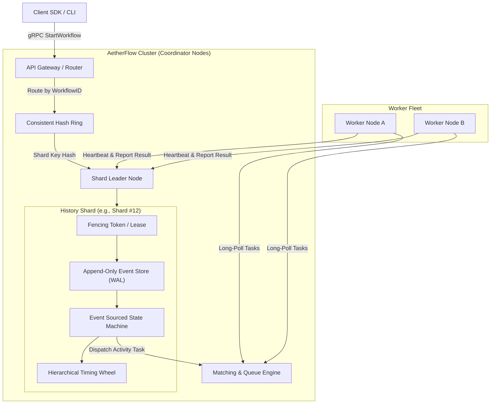
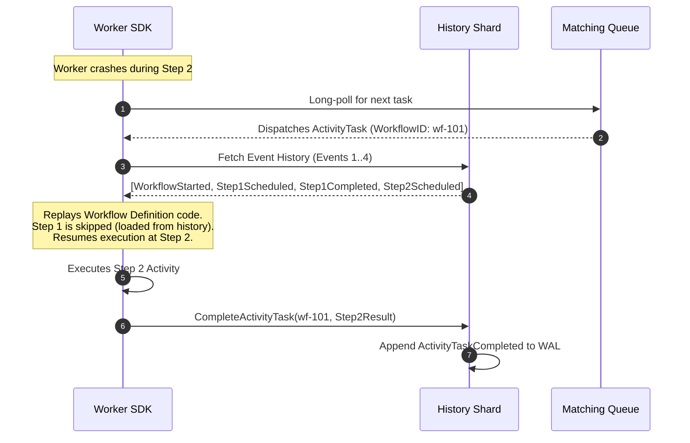
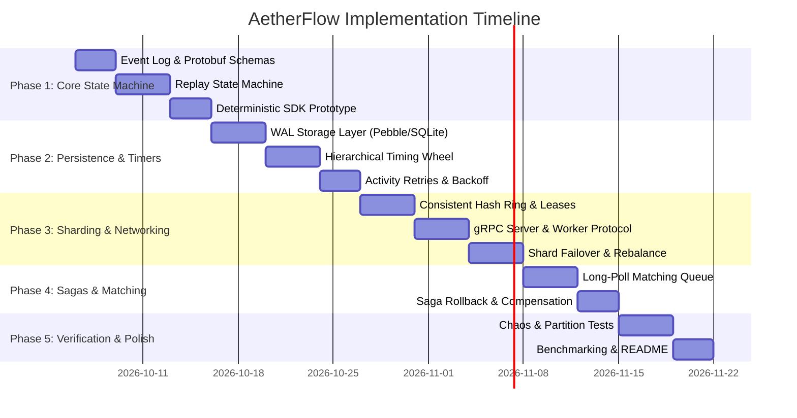

# AetherFlow: Distributed Durable Workflow & DAG Execution Engine
### Architecture, Engineering Specification & Implementation Plan

---

## 1. Project Overview & Vision

**AetherFlow** is an open-source, fault-tolerant distributed workflow and DAG orchestration engine modeled after modern durable execution systems (Temporal, Cadence, AWS Step Functions, Ray). 

### Core Value Proposition
Traditional distributed task queues (e.g., Celery, BullMQ) suffer from state loss on worker crash, lack native long-running state machines, and cannot reliably coordinate multi-step sagas without manual ad-hoc database bookkeeping. AetherFlow guarantees **durable execution**: code runs to completion even if workers die, network partitions occur, or entire coordinator nodes fail midway through execution.

### Key Architectural Pillars
- **Event-Sourced State Machine**: Workflows do not persist mutable state. State is reconstructed via deterministic replay of immutable history events.
- **Dynamic Sharding via Consistent Hashing**: Workflows are sharded across cluster nodes using a consistent hash ring with heartbeat leases and fencing tokens.
- **Hierarchical Distributed Timing Wheels**: Supports millions of long-lived delays, exponential backoffs, and execution timeouts with $O(1)$ amortized operations.
- **Worker SDK with Deterministic Sandbox**: Enforces isolation and deterministic execution rules, transparently capturing side effects and mocking them during replay.
- **Automated Saga Compensations**: First-class rollback support for distributed workflows on terminal failures.

---

## 2. System Architecture



---

## 3. Core Component Specifications

### 3.1. Event-Sourced History Engine
Workflows progress through append-only event logs. Every action emits a sequence of domain events:

| Event Type | Description |
| :--- | :--- |
| `WorkflowExecutionStarted` | Workflow initiated with input arguments, retry policies, and execution timeout. |
| `ActivityTaskScheduled` | Activity queued in a specific task queue with timeout and retry configuration. |
| `ActivityTaskStarted` | Worker acquired task lease; heartbeat timeout timer starts. |
| `ActivityTaskCompleted` | Worker successfully finished; carries activity output payload. |
| `ActivityTaskFailed` | Worker failed or timed out; triggers retry logic or compensation DAG. |
| `TimerStarted` / `TimerFired` | Durable delay registered in the hierarchical timing wheel. |
| `WorkflowExecutionCompleted` | Terminal event signaling successful or failed completion. |

#### Deterministic Replay Flow


### 3.2. Dynamic Sharding & Consensus
- **Keyspace Partitioning**: Workflows are assigned to fixed virtual shards (e.g., 1024 shards) via `fnv1a(workflow_id) % num_shards`.
- **Shard Ownership**: Nodes join a consistent hash ring with virtual nodes. Shard leases are renewed periodically via a distributed heartbeat (etcd or an internal Raft lease manager).
- **Split-Brain Mitigation**: Every shard lease contains an incremental **Fencing Token (Epoch)**. Any storage write or task dispatch with a stale epoch is rejected with `ErrStaleLeaseEpoch`.

### 3.3. Hierarchical Timing Wheel
- Efficiently tracks timeouts across thousands of concurrent workflows.
- Multi-tier wheel structure:
  - **Tier 1 (Seconds)**: 60 buckets (1s resolution, 1 minute range)
  - **Tier 2 (Minutes)**: 60 buckets (1m resolution, 1 hour range)
  - **Tier 3 (Hours)**: 24 buckets (1h resolution, 1 day range)
  - **Tier 4 (Days)**: Overflow persistent storage for long delays (> 24 hours)
- Operations: $O(1)$ addition, $O(1)$ cancellation, $O(1)$ tick advancement.

### 3.4. Worker SDK & Determinism Guard
- **Deterministic APIs**:
  - `ctx.Now()`: Returns the event timestamp recorded in history, never `time.Now()`.
  - `ctx.Sleep(duration)`: Emits a `TimerStarted` event; yields execution until waking up.
  - `ctx.SideEffect(fn)`: Executes `fn` once, persists the result in the log, and returns the cached result upon replay.
- **Drift Detection**: The SDK tracks branch decisions and activity call sequences. If replay encounters a mismatched activity call compared to history, it raises a `NonDeterministicWorkflowError`.

---

## 4. Phase-by-Phase Implementation Roadmap



### Phase 1: Event Log & Deterministic Replay (Single Node)
- [ ] Define Protocol Buffers in `api/proto/v1/events.proto`:
  - `Event`, `History`, `WorkflowExecutionStarted`, `ActivityTaskScheduled`, etc.
- [ ] Implement `pkg/history/state_machine.go`:
  - In-memory event transition handler.
  - Replay driver feeding events into workflow functions.
- [ ] Implement `pkg/sdk/workflow.go`:
  - Context wrapper providing `ExecuteActivity`, `Now`, and `Sleep`.
- [ ] Deliverable: Unit tests proving a workflow stopped after step 1 can replay from history and finish step 2 without re-running step 1.

### Phase 2: Storage Layer & Distributed Timing Wheel
- [ ] Implement pluggable storage in `pkg/storage`:
  - Embedded storage engine (Pebble DB or SQLite WAL) for event sequences.
- [ ] Implement `pkg/timer/timing_wheel.go`:
  - Hierarchical timing wheel supporting insertion, tick, and cascade between wheels.
  - Persistent backup for timers scheduled across shard reboots.
- [ ] Implement exponential backoff with full jitter for failed activity tasks.
- [ ] Deliverable: Benchmark showing the timing wheel handles 100,000 active concurrent timers with sub-millisecond tick overhead.

### Phase 3: Cluster Sharding & Network Protocols
- [ ] Implement `pkg/cluster/hashring.go`:
  - Consistent hash ring with 256 virtual nodes per physical host.
- [ ] Implement shard leasing and heartbeat mechanics in `pkg/cluster/coordinator.go`:
  - Lease acquisition, periodic heartbeat renewal, epoch fencing tokens.
- [ ] Implement gRPC services in `pkg/server`:
  - `WorkflowService.StartWorkflowExecution`
  - `WorkflowService.PollActivityTaskQueue`
  - `WorkflowService.RespondActivityTaskCompleted`
  - `WorkflowService.RespondActivityTaskFailed`
- [ ] Deliverable: Multi-node cluster where killing one coordinator causes peer nodes to reclaim its shards within 3 seconds.

### Phase 4: Matching Engine & Distributed Sagas
- [ ] Implement pull-based task queue in `pkg/matching`:
  - In-memory lock-free task buffers with long-poll timeouts.
  - Activity lease heartbeats (detect worker death during active work).
- [ ] Implement Saga Compensation Orchestration in `pkg/sdk/saga.go`:
  - Compensation registry: `saga.AddCompensation(rollbackFn)`.
  - Topological unwind on unhandled activity errors.
- [ ] Deliverable: End-to-end trip booking workflow (Flight $\rightarrow$ Hotel $\rightarrow$ Car Rental) where Car Rental fails and prior reservations are automatically cancelled.

### Phase 5: Chaos Testing, Benchmarking & Portfolio Polish
- [ ] Automated Fault Injection Suite (`tests/chaos/`):
  - Worker kill mid-activity.
  - Coordinator kill during shard reassignment.
  - Simulated latency and packet drop via Toxiproxy.
- [ ] Performance Benchmarks:
  - Workflow completions per second (TPS).
  - P50, P95, P99 task scheduling latency under load.
- [ ] GitHub Presentation Assets:
  - Architecture and sequence diagrams (Mermaid / SVG).
  - 1-command `docker-compose.yml` demo.
  - Interactive CLI (`aetherctl`) with live terminal progress view.

---

## 5. Technology Stack

| Layer | Selected Tech | Rationale |
| :--- | :--- | :--- |
| **Language** | **Go (Golang)** | Excellent concurrency primitives (goroutines, channels), clean networking/gRPC ecosystem, widely used for distributed infrastructure (Kubernetes, Docker, CockroachDB, Temporal). |
| **RPC / Serialization** | **gRPC + Protocol Buffers v3** | Strict contract enforcement, efficient binary wire serialization, built-in bi-directional streaming for heartbeats. |
| **Storage Engine** | **CockroachDB Pebble / SQLite** | High-performance LSM-tree / WAL with minimal operational overhead and zero external dependencies for local runs. |
| **Clustering / Membership** | **HashiCorp Serf / Memberlist** or **Etcd leases** | Battle-tested gossip protocol and SWIM failure detector for cluster membership. |
| **Chaos Testing** | **Toxiproxy + Docker SDK** | Deterministic network partition and socket degradation testing. |

---

## 6. Repository Layout

```text
aetherflow/
├── api/
│   └── proto/v1/              # Protobuf definitions
│       ├── events.proto
│       └── service.proto
├── cmd/
│   ├── aetherd/               # Cluster coordinator daemon
│   ├── aetherctl/             # CLI for cluster inspection & triggering runs
│   └── worker-example/        # Sample worker executing workflows
├── pkg/
│   ├── cluster/               # Consistent hashing, membership, shard leases
│   ├── history/               # Event-sourced state machine & replay engine
│   ├── matching/              # Task queue dispatch & worker polling
│   ├── timer/                 # Hierarchical timing wheel
│   ├── storage/               # Pluggable WAL & event persistence
│   └── sdk/                   # Developer SDK (Workflows, Activities, Sagas)
├── tests/
│   ├── integration/           # Multi-node integration tests
│   └── chaos/                 # Fault injection & partition tests
├── docs/                      # Architectural decision records (ADRs)
├── docker-compose.yml
├── Makefile
├── README.md
└── plan.md                    # This roadmap
```

---

## 7. Immediate Next Steps

1. **Bootstrap Project Repository**:
   - Initialize Go module (`go mod init github.com/<user>/aetherflow`).
   - Create directory structure and Protobuf compilation Makefile.
2. **Implement Phase 1 Milestone 1**:
   - Create Protobuf event definitions.
   - Write the core in-memory state machine test suite.
